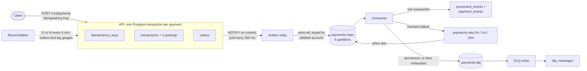
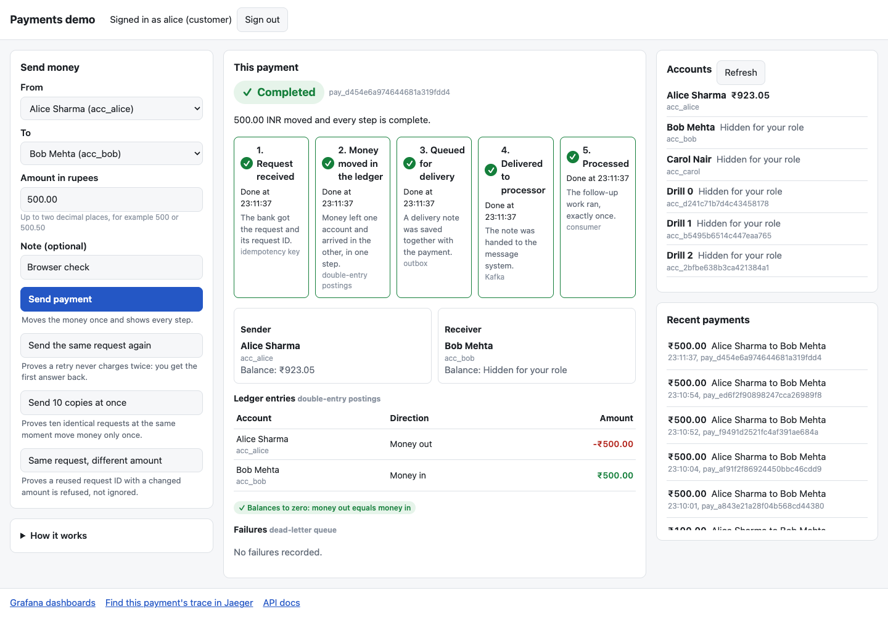

# Idempotent payment event processing

[](https://github.com/rajrahul1106/idempotent-payments/actions/workflows/ci.yml)

A payments backend that accepts transfers over HTTP and applies each one to a double-entry ledger exactly once, even when clients retry, the broker redelivers and consumers crash mid-transaction. Each payment, its two postings, its idempotency key and an outbox event commit in one Postgres transaction. A relay publishes the event to Kafka, and consumers apply it under a dedup record that commits with the side effect. The guarantee is **at-least-once delivery with exactly-once processing**: a message may arrive more than once, and its effect is applied once. It holds under failure injection, checked against a manifest of every request.

## Architecture



No component calls another over HTTP: everything goes through Postgres or Kafka (Redpanda locally), so no request state lives only in memory. The design is in [docs/ARCHITECTURE.md](docs/ARCHITECTURE.md), every endpoint with a real request and response in [docs/API.md](docs/API.md), and the failure procedures in [RUNBOOK.md](RUNBOOK.md).

## The four invariants

```
I1  No event_id is applied more than once
I2  SUM(amount) across all postings equals exactly 0
I3  Every committed outbox row is eventually published at least once
I4  No customer account balance is negative at any observable point
```

The database enforces what it can: a unique key per idempotency key and per `(event_id, consumer group)`, a deferred trigger that refuses any transaction whose postings do not sum to zero, and rules that make postings append-only. The reconciliation process checks all four every five minutes, and every test and chaos run asserts them.

## Results

Measured on one machine: a **MacBook Air, Apple M2, 8 GB, fanless**, running the whole stack (13 containers) in a Docker VM with 3.83 GB and 8 CPUs, on AC power with Low Power Mode off, with the load generator on the host. Throughput on this machine depends on its temperature, so it is a range, not one number. Every figure below comes from the JSON files in [docs/results/](docs/results/), and [docs/results/README.md](docs/results/README.md) has the full tables.

### Steady state, no faults

`make baseline`, run first on a cool machine: the chaos mix at a fixed number of concurrent clients, 2 minutes per step. An error is any status other than 200 or 201.

| Clients | Requests/s | Payments created/s | p50 ms | p95 ms | p99 ms | Errors |
| --- | --- | --- | --- | --- | --- | --- |
| 4 | 205.2 | 174.9 | 18.5 | 32.2 | 47.8 | 0 |
| 8 | 180.4 | 153.4 | 42.7 | 72.1 | 99.1 | 0 |
| 16 | 161.7 | 137.2 | 96.6 | 160.0 | 205.2 | 0 |
| 32 | 162.6 | 138.2 | 177.1 | 408.0 | 612.7 | 0 |
| 64 | 155.4 | 132.5 | 377.9 | 726.3 | 937.1 | 0 |

**Sustained: 205 requests/s (175 payments created/s) at p99 48 ms with zero errors.** That is the highest step with p99 under 500 ms and no errors. What caps it is the single API process: one uvicorn worker held at about 1.1 cores at every step while the VM as a whole stayed two-thirds idle. The relay, the NOTIFY lock and memory were measured and were not the limit ([docs/results/README.md](docs/results/README.md#what-limited-it)).

### Chaos

`make chaos` runs five fault scenarios under load. Each run is checked against a manifest of every request it made:

- exactly one transaction per idempotency key the client was paid for
- one consumer effect per event
- a DLQ holding exactly the injected malformed messages
- nothing sent to a retry topic
- every balance equal to the arithmetic of its payments
- I1 to I4 passing
- no HTTP 500 at all

| Scenario | Fault | Runs | Verdicts | Recovery after the fault |
| --- | --- | --- | --- | --- |
| consumer-kill | SIGKILL one of two consumers | 6 | 6 PASS | 47 to 52 s (the 45 s session timeout hands its partitions over) |
| broker-outage | Stop Kafka for 60 s | 7 | 6 PASS, 1 INVALID (resource) | 48 to 66 s after Kafka restarts |
| db-restart | Restart Postgres | 6 | 6 PASS | 0 to 1.3 s |
| relay-kill | SIGKILL the relay, restart after 10 s | 6 | 6 PASS | 4.5 to 6.5 s |
| db-outage | Stop Postgres for 60 s | 4 | 4 PASS | Nothing left to apply; the first payment succeeded within 0.75 s of Postgres accepting connections |

- **29 runs, 28 PASS, 0 FAILED, 1 INVALID.** The INVALID run is an early 5,000-operation run where the Docker VM fell below the 300 MB free-memory floor, which is a resource result, not a correctness one.
- **Three consecutive clean rounds** of all five scenarios at 20,000 operations each. Throughput across those rounds ranged from 99.5 to 181.6 requests/s as the laptop throttled under sustained load.
- **603,000 operations across the 28 passing runs.** They were 506,848 new payments, each applied exactly once; 89,767 resends of an earlier key with the same body, each answered with the stored response; and 6,385 malformed messages, each isolated in the DLQ.
- **Zero HTTP 500s in 600,567 HTTP attempts.** The 3,952 503s came while the database was restarting or stopped; the client retried each with the same key.
- **Every request made during the 60 s database outages got 503** (928 to 944 per run), never 500, and consumers sent nothing to a retry topic or the DLQ.

**How these are counted** (`python scripts/results_totals.py` reproduces them):

- A run is one `docs/results/chaos-*.json` file, and its verdict is the file's own.
- An operation is one entry of that run's seeded plan: a new payment, a same-key resend, or a malformed message published straight to Kafka.
- The counts are the files' `load` and `final_statuses` fields, summed.
- Runs were sized 3,000 (1), 5,000 (5), 20,000 (19) and 50,000 (4). With the INVALID run included there are 608,000 operations. The baseline adds 103,578 requests, none of them an error.

## Quickstart

You need Docker with Compose v2 (give its VM at least 4 GB, and 6 GB if you can), Python 3.13, make and git. The stack uses ports 3000, 4317, 5433, 8000, 9090, 9644, 16686 and 19092.

```bash
git clone https://github.com/rajrahul1106/idempotent-payments.git
cd idempotent-payments
make setup
make up
make test
```

`make setup` creates `.venv` from the locked dependencies, and the Makefile uses it, so there is nothing to activate. `make up` builds and starts the stack, waits until every service is healthy, then applies the migrations and seeds the demo accounts and users. `make test` runs the 272 tests that need PostgreSQL and Kafka, in about three minutes. They use their own `payments_test` database, never the one the stack serves.

When the stack is up:

| What | Where |
| --- | --- |
| The API and its OpenAPI page | http://localhost:8000/docs |
| Grafana (anonymous access, for local use only) | http://localhost:3000 |
| Jaeger | http://localhost:16686 |
| Prometheus | http://localhost:9090 |

Other targets:

- `make test-property`: the Hypothesis state machine, 200 examples, about 4 minutes
- `make chaos`: the five scenarios at 20,000 operations each, about 16 minutes
- `make baseline`: the steady-state steps, about 12 minutes
- `make down`: stop everything and delete the volumes

## Try the demo page

With the stack up, open **http://localhost:8000/demo** and sign in as `alice` (a customer), `operator` (bank staff) or `auditor` (read-only); the development passwords are in `scripts/seed.py`.
Send money and watch the payment go through each step: request received, money moved in the ledger, queued, delivered and processed.
Send the same request again, or ten copies at once, to see a repeat answered without charging twice.



## Design decisions

Each decision, with its alternatives, is in [docs/ARCHITECTURE.md](docs/ARCHITECTURE.md#13-rejected-alternatives).

- **Transactional outbox, not a publish from the request handler.** No transaction spans Postgres and Kafka, so publishing directly would be two writes that can disagree. With the outbox, the event row commits with the payment and publishing follows from that commit. The relay may publish a row twice, and the consumer is built for that.
- **Rejected: Kafka transactions.** They give end-to-end exactly-once only when both the source and the sink are Kafka. The sink here is Postgres, so consumer-side dedup would be needed anyway, and Kafka transactions would add throughput cost and consumer configuration on top.
- **Rejected: Debezium change data capture.** It reads the write-ahead log with no polling, and it is the stronger production answer. Here it would mean running Kafka Connect and a connector for one table. The relay polls every 200 ms and wakes on LISTEN/NOTIFY, so the publish delay stayed under 0.4 s at p95 under load. Debezium is the natural next step.
- **Rejected: a stored balance.** A balance column has no audit trail and no self-check. A balance derived from append-only postings gives an invariant anyone can run: the sum of all postings is zero. If an account's history grew into millions of rows, the next step would be a periodic snapshot, not a mutable column.
- **Rejected: SERIALIZABLE.** It would prevent the double-spend race without explicit locks, but every write would then need retry-on-conflict handling. The system runs at READ COMMITTED with `SELECT ... FOR UPDATE` on both accounts. Locks are taken in ascending id order, so opposite transfers cannot deadlock, and the balance check runs inside the lock. The critical section stays visible in the code.
- **Rejected: Redis for idempotency or rate limits.** As an idempotency cache it would be a second source of truth, and the authority has to be the store with the unique constraint. Postgres answers the key lookup in well under a millisecond here. The cost of not having Redis is the in-memory rate limiter (see the first limitation below).
- **Money:** `NUMERIC(20,4)` in Postgres, `Decimal` in Python, and integer minor units on the wire. A float amount is refused, not rounded. One module converts between them, and `make check` fails the build if `float` appears in a monetary annotation.
- **Idempotency key fingerprint.** A key reused with a different body gets 422 rather than the first response, because silently returning the first response would hide a client bug.
- **Kafka keyed by the debited account,** so one account's events stay in order on one partition. Ledger correctness does not depend on Kafka order, because the postings commit in the API transaction.
- **Failure classification (D5).** A malformed message goes straight to the DLQ. A database outage holds messages where they are, so it never floods the DLQ. Anything else goes through 5 s, 1 min and 10 min retry topics, so it never blocks the partition behind it.

## Known limitations

The full list is in [docs/ARCHITECTURE.md §15](docs/ARCHITECTURE.md#15-known-limitations).

- **The API runs as a single worker, and that caps throughput.** The rate limiter (100 requests a minute per token) keeps its buckets in process memory. Two API processes or two uvicorn workers would each keep their own buckets and allow twice the limit. So the API is one uvicorn worker, one Python interpreter at about 1.1 cores, and that is the measured ceiling of about 205 requests a second. A shared limiter (Redis, or a Postgres table) would allow more workers.
- **`sys_settlement` is a hot account by construction.** Every deposit and every withdrawal posts one leg to it, so they all serialise on its row lock, whatever customer accounts they touch. Under a burst of deposits it is the first place 503 `service_busy` appears; the client retries with the same key. It is accepted, not sharded, because splitting it would change the ledger's shape and the reconciliation of settlement balances. Payments between customer accounts never touch it.
- **Any hot account is a queue.** Payments touching one account wait for its row lock. A wait over 3 s returns 503 `service_busy` with `Retry-After: 1`, and the same key can be retried.
- **One Postgres, no replica.** While it is down, writes are refused with 503, and everything recovers on its own when it returns. Production would need a standby.
- **There is a window between commit and publish.** A payment is in Postgres before it is in Kafka. The publish delay is measured and alerted on, not eliminated.
- **A retrying message loses its place** in its account's order (D6). Later events for that account are applied first. The ledger is unaffected, because the postings committed in the API.
- **The consumer's side effect is a projection table,** not a call to an external system. A real integration would add timeouts and its own idempotency contract.
- **Out of scope:** encryption at rest, mTLS, key rotation, refresh tokens. The outbox is never pruned.
- **All numbers come from one fanless 8 GB laptop.** The relay's ceiling and the NOTIFY lock's ceiling were never reached, because the API saturated first, so both are unmeasured.

## How it was verified

- **Tests:** 272 in `make test`, against real PostgreSQL and Kafka, never mocks, because a mocked broker cannot redeliver. Database and messaging tests fail rather than skip when a service is missing, and any warning fails the run.
  - Idempotency: 10 concurrent identical requests produce one transaction; same key with a different body gets 422.
  - Concurrency: overdraw races, opposite-direction transfers with no deadlock, and the arithmetic under 10 clients.
  - Messaging: 1,000 events with 300 duplicates produce exactly 700 effects; a consumer and a relay are SIGKILLed mid-batch.
  - Retry and DLQ: 50 malformed messages among 5,000 good ones, and DLQ replay.
  - Tracing: one trace across all four processes.
- **Chaos suite:** five scenarios, each judged against its own manifest (see Results), across 29 recorded runs. Three consecutive rounds of all five passed clean.
- **Property-based testing:** a Hypothesis state machine (`make test-property`, 200 examples) drives the real API, database and broker. It generates account creation, deposits, transfers, overdraws, replays, key reuse with a different body, four concurrent withdrawals of a whole balance, and a consumer crash between its database commit and its offset commit. After every step it checks a model of every balance against the database, plus I1 to I4.
- **Mutation checks:** two deliberate bugs were run against the property suite and then reverted. Both were caught, and the shrunk sequences are kept in `tests/regression/`, where they run in `make test`.
  - **The balance check moved outside the account lock:** Hypothesis shrank it to a deposit of 0.01 and four concurrent 0.01 withdrawals, all accepted, leaving -0.03 (I4).
  - **The side effect applied even when its dedup record was not new:** it shrank to one deposit and one consumer crash between the two commits. The redelivery was retried instead of skipped (I1).
- **Operations:** each of the seven [RUNBOOK.md](RUNBOOK.md) procedures was executed against the stack with its real output recorded. All 15 alert rules have `promtool` unit tests (`make rules`).

### Continuous integration

[`.github/workflows/ci.yml`](.github/workflows/ci.yml) runs on every push and pull request, installing from `requirements.lock`:

- `make check`
- the 128 unit tests
- 118 integration, API, concurrency and relay tests, against a PostgreSQL service container

The 26 tests marked `messaging` (consumers, retry tiers, DLQ, cross-process tracing and the two regression sequences) are not in CI. They need a Kafka broker started with a custom command, which GitHub's service containers cannot do, and they have not yet been shown to run reliably on CI runners. They run locally in `make test`, and in every chaos run.

## Repository layout

```
app/          API, services, messaging processes, database models and repositories
migrations/   Alembic migrations
tests/        unit, integration, api, concurrency, messaging, property, regression
scripts/      seed, chaos and baseline runners, the results report and totals
monitoring/   Prometheus rules (with tests) and Grafana dashboards
docs/         ARCHITECTURE.md, API.md, results/
```

## License

[MIT](LICENSE)
