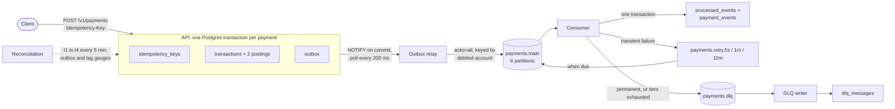

# Architecture

The design of the idempotent payment event processing system, as built. Section numbers are stable: code comments cite them (for example "§5.4" or "decision D21, §16").

- [1. Overview](#1-overview)
- [2. Failure modes and the mechanism for each](#2-failure-modes-and-the-mechanism-for-each)
- [3. Components](#3-components)
- [4. Schema](#4-schema)
- [5. Mechanisms](#5-mechanisms)
- [6. Technology](#6-technology)
- [7. API](#7-api)
- [8. The write path, step by step](#8-the-write-path-step-by-step)
- [9. Guarantees, isolation and security](#9-guarantees-isolation-and-security)
- [10. Testing](#10-testing)
- [11. Monitoring and operations](#11-monitoring-and-operations)
- [12. Code layout](#12-code-layout)
- [13. Rejected alternatives](#13-rejected-alternatives)
- [14. Measured results](#14-measured-results)
- [15. Known limitations](#15-known-limitations)
- [16. Decisions and accepted deviations](#16-decisions-and-accepted-deviations)

## 1. Overview

The system accepts payment instructions over HTTP and applies each one to a double-entry ledger exactly once, even when clients retry, the broker redelivers, and consumers crash mid-transaction.

It is a payment processing backend, not a payment product: no user interface, no card network, no settlement with a real bank. It is the correctness machinery that sits underneath one.

The delivery guarantee, stated precisely: **at-least-once delivery with exactly-once processing**. A message may be delivered more than once; its effect is applied once. Exactly-once delivery across a network is not achievable, and the system does not claim it.

Five properties set it apart from a balance column updated in a request handler:

- Balance is derived from immutable postings, never stored and mutated.
- Money is a decimal with a fixed scale, never a float.
- The database, not application code, enforces uniqueness on idempotency keys and event ids.
- Publishing to Kafka is a consequence of a committed transaction, never a second write that can diverge.
- Correctness is asserted by executable invariants (§10), not by a happy-path test.

## 2. Failure modes and the mechanism for each

Distributed payment systems lose money because the network cannot say whether work happened. Six failure modes each get their own mechanism; treating them all as "idempotency" is how a system passes its tests and fails in production.

| # | Failure mode | What goes wrong | Mechanism |
| --- | --- | --- | --- |
| 1 | Client retry | The caller cannot tell a lost request from a lost response, retries, and is debited twice | Idempotency key with a payload fingerprint, under a unique index |
| 2 | Dual write | The database commit succeeds and the Kafka publish fails, or the reverse, and the two disagree | Transactional outbox: the event row commits with the business rows |
| 3 | Broker redelivery | Kafka is at-least-once; the same message arrives twice | Consumer dedup on `event_id`, inserted in the same transaction as the side effect |
| 4 | Consumer crash | The side effect is applied, the offset is not committed, and the replay applies it again | Side effect and dedup record share one database transaction |
| 5 | Concurrent writes | Two withdrawals read the same balance, both pass the check, the account goes negative | Row lock on the accounts, balance check inside the lock |
| 6 | Money precision | Float arithmetic loses fractions, and totals drift over millions of rows | `NUMERIC(20,4)` in Postgres, `Decimal` in Python, integer minor units on the wire |

A client sends a UUID per payment intent as the `Idempotency-Key` header. The server stores it with a SHA-256 fingerprint of the canonical body under a unique index. The same key with the same body returns the stored response without touching the ledger; the same key with a different body is a client bug and returns 422.

The write path commits, in one Postgres transaction, the transaction row, two postings that sum to zero, the idempotency key with its stored response, and an outbox row holding the event. All land or none do.

A relay publishes unpublished outbox rows to Kafka. It may publish a row twice if it crashes between publishing and marking, which is acceptable: the consumer tolerates duplicates, so the relay only needs at-least-once behaviour. The consumer inserts into `processed_events` and applies its side effect in one transaction. A conflict on `event_id` means the event was handled already, so it is skipped and its offset committed.

## 3. Components



Postgres and Kafka (Redpanda locally) are the stateful components; only Postgres must be ACID. The processes:

| Component | Owns | Never does |
| --- | --- | --- |
| API (`app/main.py`) | Validation, authentication, the idempotency decision, the payment transaction | Publish to Kafka. It writes an outbox row instead |
| PostgreSQL | Everything that must be correct: accounts, postings, keys, outbox, dedup records, dead letters | Hold an account or ledger row lock across a network call (the relay's outbox row locks are the one exception, D1) |
| Outbox relay (`app/messaging/relay.py`) | Publishing unpublished rows in id order, marking them published | Promise to publish only once. It may republish, by design. Run as more than one instance (D1) |
| Kafka | Durable transport, partition order, consumer groups | Act as a system of record. It is transport, not truth |
| Consumer (`app/messaging/consumer.py`) | Dedup on `event_id` and the side effect in one transaction | Commit its offset before the database transaction commits |
| Retry tiers (`app/messaging/retry_tier.py`) | Holding a failed message until its delay passes, then returning it to the main topic | Block the main topic |
| DLQ writer (`app/messaging/dlq_writer.py`) | Recording every dead letter in `dlq_messages` with its failure history | Skip a dead letter it cannot write (§11, scenario 7) |
| Reconciliation (`app/services/reconciliation.py`) | The four invariant checks every five minutes; the gauges that must outlive the processes they watch (D17) | Repair anything. A human decides |

**Why the split.** The API returns as soon as the transaction commits; publishing can be slow or fail, and coupling the two would tie a payment's latency to broker health. The relay and the consumer fail differently (one delays publishing, the other processing), so either can be restarted without the other. Each retry tier is its own process so that a 10-minute delay occupies only its own topic: the broker keeps the timers.

**Communication.** No component calls another over HTTP. Every interaction goes through Postgres or Kafka, so there is no in-flight request state held in memory anywhere, which is what makes crash behaviour analysable. The API uses a pool of 20 connections plus 5 overflow. The relay produces with `acks=all` and `enable.idempotence`. Consumers run with `enable.auto.commit=false`.

**Why Kafka.** Two features are load-bearing: partition order gives per-account sequence, and offset-based replay lets a consumer group reprocess a day of events by resetting its offsets. Without those, a simpler queue would be the better choice.

## 4. Schema

Ten tables. Correctness is enforced by constraints, because application code can be bypassed by the next change and a constraint cannot. Migrations are in `migrations/versions/` (§16, Migrations).

| Table | Holds |
| --- | --- |
| `accounts` | Id, holder, currency, `customer` or `system`, `active`/`frozen`/`closed` |
| `transactions` | One row per payment: amount `NUMERIC(20,4) > 0`, currency, reference, metadata, and `reverses_transaction_id` for a reversing pair |
| `postings` | The ledger: append-only rows, two or more per transaction, summing to zero |
| `idempotency_keys` | Key (UUID, primary key), fingerprint, state, the stored response, expiry |
| `outbox` | Events to publish: `event_id` (unique), type, `schema_version`, partition key, payload, `traceparent`, `published_at` |
| `processed_events` | Dedup records: primary key `(event_id, consumer_group)` |
| `payment_events` | The consumer's side effect: one row per applied event (`event_id` unique) |
| `dlq_messages` | Dead letters: payload, reason, attempts, failure history, `traceparent`, `replayed_at` |
| `reconciliation_runs` | One row per check per run |
| `auth_users` | Seeded users behind `/v1/auth/token`, argon2id hashes |

### Constraints that carry the guarantees

```sql
-- A transaction's postings must sum to zero, checked at COMMIT (DEFERRED),
-- so both legs can be inserted first. Raises SQLSTATE 23514.
CREATE CONSTRAINT TRIGGER postings_balance_check
    AFTER INSERT ON postings
    DEFERRABLE INITIALLY DEFERRED
    FOR EACH ROW EXECUTE FUNCTION assert_balanced_transaction();

-- Postings are append-only.
CREATE RULE postings_no_update AS ON UPDATE TO postings DO INSTEAD NOTHING;
CREATE RULE postings_no_delete AS ON DELETE TO postings DO INSTEAD NOTHING;
```

The deferred trigger is the most important line in the schema: an unbalanced transaction cannot commit, whatever the application does.

### Indexes

| Index | Table | Purpose |
| --- | --- | --- |
| `(account_id, created_at DESC)` | postings | Balance derivation and history, the hottest query |
| `(transaction_id)` | postings | Both legs of a payment |
| `(event_id)` | postings | Tracing an effect back to its event |
| `(id) WHERE published_at IS NULL` | outbox | Partial: the relay reads only unpublished rows, in id order, one batch at a time; the index stays the size of the backlog |
| `(created_at)` | outbox | Publish delay |
| `(expires_at)` | idempotency_keys | Expired-key cleanup |
| `(event_id) WHERE replayed_at IS NULL` | dlq_messages | What still needs an operator |

### Balance and concurrency

```sql
-- Always derived, never stored
SELECT COALESCE(SUM(amount), 0) FROM postings WHERE account_id = $1;

-- The critical section: lock in ascending id order, then check, then write
SELECT id FROM accounts WHERE id IN ($from, $to) ORDER BY id FOR UPDATE;
```

A negative balance is prevented by the check inside the row lock, not by a `CHECK` constraint, which cannot see a sum over other rows. System accounts are exempt: `sys_settlement` is the counterparty of every deposit and withdrawal, so money entering or leaving the ledger still has two legs and the zero-sum invariant holds.

There is no audit table, deliberately: `postings` is already an immutable, timestamped, event-linked history of every movement. A correction is a new reversing pair, never an edit, so the balance at any past moment is a query on `created_at`.

## 5. Mechanisms

### 5.1 Double-entry ledger

Every transaction writes postings that sum to zero, and a balance is `SUM(amount)` over an account's postings. A transfer of 2,000.00 writes `(A, -2000.0000)` and `(B, +2000.0000)` under one `transaction_id`. This turns correctness into a query: `SELECT SUM(amount) FROM postings` must be exactly zero, always (I2). It runs after test files, after every chaos run, and every five minutes in the reconciliation process.

### 5.2 Decimal money

`NUMERIC(20,4)` in Postgres, `decimal.Decimal` in Python, integer minor units plus an ISO 4217 code on the wire: `{"amount_minor": 200000, "currency": "INR"}` is 2,000.00 rupees. Pydantic's `StrictInt` rejects a float at the boundary instead of coercing it. One module, `app/core/money.py`, converts between minor units and `Decimal`, and nothing else does. Four decimal places cover three-decimal currencies plus one place for intermediate arithmetic. `make check` walks the AST of `app/` and fails if `float` appears in a monetary annotation; a property test checks the conversion is lossless across the full range.

### 5.3 Partitioning by account

Kafka orders messages within a partition, not across a topic. The outbox row's `partition_key` is the debited account, and the relay uses it as the message key, so every event debiting one account lands on one partition in order (D3). Ledger correctness does not depend on Kafka order, because the postings commit in the API transaction. `payments.main` has 6 partitions; increasing that later remaps keys to partitions and breaks per-account order for the events in flight, so it needs a migration plan, not a config change.

### 5.4 Retry tiers and the dead-letter queue

Sleeping inside a consumer blocks its partition. A failed message instead moves on:

```
payments.main -> payments.retry.5s -> payments.retry.1m -> payments.retry.10m -> payments.dlq
```

Each failure is classified (D5): permanent errors (an unparseable or invalid message) go straight to the DLQ; "the database is unreachable" is held on the main topic and retried in place until the database returns, so an outage never empties the main topic into the DLQ; anything else is transient and goes to the next tier. A move publishes with `acks=all` and waits for the acknowledgement before committing the original offset (D7). Headers carry `attempt_count`, `first_failed_at`, `last_error`, `original_topic` and the failure history. A tier consumer holds a message by pausing its partition until it is due, never by sleeping in the poll loop (D9), then returns it to the main topic. After the last tier the message goes to the DLQ, and the DLQ writer records it in `dlq_messages`.

An operator replays a dead letter with `POST /v1/dlq/{id}/replay`: it is republished to the main topic with its original `event_id`, so replaying one whose effect already applied is harmless (D10).

### 5.5 Idempotency key fingerprinting

A key reused with a different body would otherwise get the first response back, and the second payment would silently disappear. The server stores a SHA-256 of the canonical body (JSON, sorted keys, no whitespace, UTF-8) with the key. Key absent: process. Present with the same fingerprint: return the stored response with `Idempotency-Replayed: true`. Present with a different fingerprint: 422 `idempotency_key_reuse`. A duplicate arriving while the first is still running waits on the first's key and gets the replayed response, or 409 `request_in_progress` after 3 s (D2).

### 5.6 Runbook

[RUNBOOK.md](../RUNBOOK.md) has a procedure for each failure scenario: symptom, the alert that fires, diagnosis, recovery, and whether the step is safe to repeat. Each was executed once against the local stack and its real output recorded (§11).

### 5.7 Property-based testing

A Hypothesis state machine (`tests/property/test_ledger_machine.py`) generates sequences of operations against the real API, database and broker, and after every step checks that a Python model of every balance matches the database and that I1 to I4 hold. Rules: create account, deposit, transfer, overdraw, replay a request, reuse a key with another body, four concurrent withdrawals of the whole balance, and a consumer crash between its database commit and its offset commit. Shrunk counterexamples are committed to `tests/regression/` (D24).

### 5.8 Distributed tracing

One trace follows a payment from the HTTP request through the outbox, the relay, Kafka, any retry tiers and the consumer to the final row. The W3C `traceparent` is stored in the outbox row, carried as a Kafka header, and re-parented at every hop, so a trace is a parent-to-child chain, not a flat set of spans (D11). A dead letter keeps its `traceparent`, and a replay continues that trace (D12). Spans carry `event_id`, `account_id` and `attempt_count`, and a SHA-256 prefix of the idempotency key, never the key itself. OTLP export goes to Jaeger locally; an exporter outage never fails a payment.

## 6. Technology

Exact versions are pinned in `requirements.txt` (direct) and `requirements.lock` (everything, transitive included); the Docker image installs from the lock.

| Technology | Version | Role | Why |
| --- | --- | --- | --- |
| Python | 3.13.2 | Implementation | Dedup lives in Postgres and Kafka, so the language costs nothing on correctness |
| FastAPI, Pydantic | 0.162.2, 2.14.3 | HTTP API, schemas | Validation at the boundary, including refusing floats; OpenAPI generated from the code |
| PostgreSQL | 16 | System of record | Unique constraints, `SELECT ... FOR UPDATE`, `SKIP LOCKED`, `NUMERIC` and deferred triggers are all load-bearing |
| SQLAlchemy, Alembic | 2.1.8, 1.20.1 | Data access, migrations | Explicit transaction boundaries; reviewable, reversible schema history |
| Redpanda | 24.2.7 | Kafka-compatible broker | Partition order and consumer groups, in one container with no ZooKeeper or KRaft setup |
| confluent-kafka | 2.16.1 | Kafka client | librdkafka, with correct manual offset control |
| pytest, Hypothesis | 9.2.0, 6.170.15 | Tests | Real Postgres and Kafka, not mocks: a mocked broker cannot redeliver |
| OpenTelemetry, Jaeger | 1.45.2 | Tracing | Vendor-neutral, continues across the broker via `traceparent` |
| Prometheus, Grafana | 2.54, 11 | Metrics, alerts, dashboards | Dashboards and alert rules are committed and provisioned by Compose |
| Docker Compose | v2 | Local stack | One command brings up all 13 services |

Deliberately excluded: Kubernetes (no guarantee changes at this size), more services than these (more failure modes, not more correctness), Celery or another queue (Kafka already is one, and a second would need its own dedup), a schema registry (JSON with an explicit `schema_version` covers evolution here), Kafka transactions and Redis (§13).

## 7. API

Twelve `/v1` endpoints plus `/health`, `/ready`, `/metrics` and `/demo`. Only `POST /v1/payments` carries idempotency semantics, because it is the only one that moves money. Every endpoint, with a curl example run against the stack and its real response, is in [docs/API.md](API.md).

**Authentication.** A bearer JWT (HS256, 15 minutes) from `POST /v1/auth/token`, against the seeded `auth_users` table with argon2id hashes. Roles: `viewer` reads, `client` pays, `operator` manages accounts, the DLQ and reconciliation. An unknown username is verified against a real argon2 hash, so it takes as long as a wrong password.

**Ownership (D4).** A client's token carries the `account_id` it owns. A client reads only that account and the payments it pays or receives, and debits only that account. Only an operator debits a system account. Ownership is checked before the idempotency lookup, so a caller cannot replay someone else's stored response.

**Errors.** One body shape on every endpoint: `{"error": {"code", "message", "request_id", "trace_id"}}`, where `trace_id` is the request's trace, so a failed request can be found from its error alone.

**Limits.** Bodies over 64 KB are refused with 413 before anything parses them; `metadata` is at most 2 KB; `reference` at most 64 characters; `amount_minor` from 1 to 10^12. A token subject may make 100 requests a minute (429 with `Retry-After`).

### 7.1 The demo page

`GET /demo` serves one static file, `app/static/demo.html`: inline CSS and JavaScript, no build step, nothing loaded from elsewhere. It holds no data and no secrets. It signs in through `POST /v1/auth/token` like any client, keeps the token in memory only, and shows only what its role's `/v1` calls return. It changes nothing about how payments are written, locked, published or deduplicated; it adds three read-only endpoints:

- `GET /v1/accounts`: the accounts the caller may see (D26), each with `can_debit`. `can_debit` is `app/services/payment.py`'s `can_debit`, the same two functions the write path enforces (one before the idempotency lookup, one under the account lock), so the page and the API cannot disagree. The page uses it only to fill its "From" list; `POST /v1/payments` still refuses anything else.
- `GET /v1/payments`: recent payments, newest first; a client sees only its own account's.
- `GET /v1/payments/{payment_id}/journey`: one payment's recorded stages (request received, ledger written, outbox row, published, processed by the main consumer group), its postings and their sum, and its dead letters, read in one REPEATABLE READ snapshot. Every field is a database row; a stage without a row is reported as not done, with the elapsed time, and nothing is guessed about why.

## 8. The write path, step by step

Steps 3 to 10 run in one Postgres transaction at READ COMMITTED.

1. **Parse.** Pydantic validates the body; a float amount, a missing field or a non-UUID `Idempotency-Key` is 400. The body cap applies before this.
2. **Authenticate and authorise.** JWT verified, role checked, debit ownership checked (D4). 401 or 403 before any database work.
3. **Begin; reserve the key.** The transaction opens and inserts the key with its fingerprint. A conflict means the key exists: the same fingerprint returns the stored response (200), a different one is 422, one still in flight is waited on (D2).
4. **Lock the accounts.** `SELECT ... FOR UPDATE` on both, in ascending id order, so opposite transfers cannot deadlock. A lock wait past 3 s is 503 `service_busy` (D21).
5. **Validate under the lock.** Both exist and are active, currencies match, source differs from destination; only an operator may debit a system account.
6. **Balance check, under the lock.** The source balance is computed from postings. Insufficient funds is 422 and rolls everything back, the key reservation included.
7. **Write the transaction row.**
8. **Write the postings,** equal and opposite. The deferred trigger checks they sum to zero at commit.
9. **Write the outbox row and the stored response,** and `pg_notify('outbox', ...)`, which is delivered only if the transaction commits (D15).
10. **Commit.** The response is sent only after the commit succeeds.
11. **Relay publishes.** It takes unpublished rows with `FOR UPDATE SKIP LOCKED`, publishes each with `acks=all` keyed by `partition_key`, then marks it published.
12. **Consumer processes.** Per event: one transaction inserts into `processed_events` and applies the side effect. An existing row means the event was handled: skip.
13. **Offset commit,** only after the database commit. A crash between the two causes a redelivery, which step 12 skips.

### What a crash leaves at each stage

| Crash point | State left | Recovery | Client impact |
| --- | --- | --- | --- |
| Steps 1 to 2 | Nothing | None needed | Retries safely |
| Steps 3 to 9 | Postgres rolls everything back | None needed | Retries with the same key, processed once |
| After commit, before the response | Payment applied, no response | The retry with the same key gets the stored response | None |
| Relay down | Outbox rows accumulate | The relay resumes from the oldest unpublished row | Downstream delayed, nothing lost |
| Relay crashes after publish, before marking | Row republished on restart | Consumer skips the duplicate | None |
| Consumer crashes mid-event | Its transaction rolls back, offset not committed | Redelivered and applied once | None |
| Consumer crashes after its commit, before the offset commit | Effect applied, offset stale | Redelivered; the dedup insert finds the row; skipped | None |
| Kafka down | The relay retries; the outbox grows; payments still succeed | The relay drains the backlog | Downstream delayed |
| Postgres down | The API answers 503; the relay and consumers hold their work (D5) | Everything resumes on reconnect, no partial state | Writes refused until it returns |

The pattern in every row: the system may do too much work, never too little. Duplicate publishing and duplicate delivery are tolerated. The database is the only component where a partial result would be fatal, and it is the only one with a transaction.

**The one window that is not closed.** Between commit (10) and publish (11) the payment exists in Postgres and not yet in Kafka. That window is the outbox publish delay: with LISTEN/NOTIFY it was at most 0.39 s at p95 under load (§14), bounded by the 200 ms poll without it. It is measured and alerted on, not eliminated.

## 9. Guarantees, isolation and security

### What the architecture guarantees

| Guarantee | Mechanism | Holds even if |
| --- | --- | --- |
| An idempotency key produces at most one transaction | Primary key on `idempotency_keys.key` | Many concurrent requests carry the same key |
| The ledger sums to zero | Postings in one transaction, deferred zero-sum trigger | Any process crashes at any point |
| An event applies its side effect at most once | Primary key on `processed_events`, inserted in the effect's transaction | Kafka redelivers any number of times |
| A committed payment is eventually published | The outbox row commits with the payment; the relay retries forever | Kafka is down for hours |

### What needs operational controls

| Not guaranteed by code | What it needs |
| --- | --- |
| Publish latency stays low | The relay monitored and alerted on (§11) |
| The DLQ gets drained | A person following the runbook; nothing drains it automatically |
| Balances stay non-negative over time | The in-lock check covers every payment; an administrative posting could still break it, and reconciliation catches that |
| Kafka keeps events long enough to replay | Retention of 7 days, a deployment setting |
| Secrets stay secret | `.env` locally; production needs a secret manager. The app refuses the placeholder JWT secret outside `local` and `ci` |

### Delivery semantics

- **At-least-once delivery.** The relay and Kafka may deliver a message more than once. Neither drops one that was committed.
- **Exactly-once processing.** Each `event_id` produces its side effect once, because the dedup record and the effect commit atomically.
- **Per-account ordering.** Events debiting one account reach one partition in publish order. No order is claimed across accounts. A message that goes through a retry tier is the exception: later events for that account are processed before it (D6).

### Isolation

READ COMMITTED, Postgres's default. SERIALIZABLE is not needed, because every read a write decision depends on happens under an explicit row lock (§13 says why that was chosen). Without the lock, two withdrawals of 800 from 1,000 would both read 1,000 and both commit, leaving -600; with it, the second waits, re-reads 200 and fails with `insufficient_funds`. Locks are taken in ascending account id order, with a test that asserts it, and held only for the transaction, which does no network I/O.

### Security

- **Authentication:** JWT HS256, 15-minute expiry, argon2id password hashes, constant-cost login for unknown users.
- **Authorization:** role dependencies per route, plus ownership (D4).
- **Input:** Pydantic at the boundary, parameter binding everywhere (no SQL built from input), 64 KB body cap, 2 KB metadata cap.
- **Rate limiting:** a per-token-subject token bucket, 100 a minute, in memory: correct for one API process only (§15, limitation 2).
- **Audit:** postings are append-only by database rule, and carry `created_at` and the `event_id` that produced them.
- **Traces and metrics** carry no tokens, request bodies or raw idempotency keys, and metric labels are bounded (a test fails on an id-like label).
- **Out of scope:** mTLS between services, encryption at rest, key rotation, refresh tokens, PII masking in logs beyond account ids.

### Reconciliation

The reconciliation process runs the four invariant checks every five minutes in one REPEATABLE READ snapshot and writes a row per check to `reconciliation_runs`; `GET /v1/admin/reconciliation` runs them on demand. I1, I2 and I4 fail; I3 warns when an outbox row is unpublished for over 60 s. I1 is checked in the ledger, as an `event_id` whose postings span more than one transaction, because `processed_events`' primary key makes a duplicate there impossible. A failure is a correctness break: the runbook stops the consumers first and investigates second.

## 10. Testing

### The four invariants

```
I1  No event_id is applied more than once
I2  SUM(amount) across all postings equals exactly 0
I3  Every committed outbox row is eventually published at least once
I4  No customer account balance is negative at any observable point
```

Every test defends one of them; a test of implementation detail goes when the implementation changes.

### Test levels

| Level | Where | Needs | Tests | Run by |
| --- | --- | --- | --- | --- |
| Unit | `tests/unit` | Nothing | 128 | `make test-fast`, CI |
| Integration, API, concurrency, relay | `tests/integration`, `tests/api`, `tests/concurrency`, `tests/messaging` (relay) | PostgreSQL | 118 | `make test`, CI |
| Messaging and regression | `tests/messaging`, `tests/regression` | PostgreSQL and Kafka | 26 | `make test` |
| Property | `tests/property` | PostgreSQL and Kafka | 1 state machine, 200 examples | `make test-property` |
| Chaos | `scripts/chaos_run.py` | The whole stack | 5 scenarios | `make chaos` |

Tests run against real services: the Compose stack's Postgres with a separate database whose name must end in `_test` (the suite refuses any other), and per-run Kafka topics and consumer groups. Database and messaging tests fail, never skip, when their service is missing, so a green run means they ran. Any warning fails the run.

Representative cases:

- **Idempotency:** ten concurrent requests with one key give one transaction and ten identical responses; same key, different body is 422 with no second transaction; a key whose request failed with 422 is reusable.
- **Concurrency:** two simultaneous withdrawals that together overdraw, repeated 10 times: exactly one succeeds every time; 50 transfers between two accounts, half in each direction, 8 at a time: no deadlock; 100 operations on one account from 10 concurrent clients: the final balance is the arithmetic sum; 20 payments against an account held locked: every answer is 201 or 503, never 500.
- **Messaging:** 1,000 events of which 300 are duplicates give exactly 700 effects; a consumer killed mid-batch and restarted applies every event once; a relay killed with 50 unpublished rows publishes all 50 on restart.
- **Retry and DLQ:** 50 poison messages among 5,000 good ones all reach the DLQ with their history while the good ones flow; a transient failure that succeeds on its third attempt never reaches the DLQ; replaying an applied dead letter is skipped; a database outage holds messages instead of dead-lettering them.

### Chaos suite

`make chaos` runs five scenarios, each a seeded plan of operations: about 85% new payments, 15% resends of an earlier key with the same body, 1% malformed messages published straight to `payments.main`, and about 10% of payments touching one hot account. The client retries a 503 or 409 with the same key, as a well-behaved client would.

| Scenario | Fault |
| --- | --- |
| consumer-kill | Two consumers; SIGKILL one at a random point |
| broker-outage | Stop Redpanda for 60 s mid-load, then start it |
| db-restart | Restart Postgres mid-load (a sub-second blip) |
| relay-kill | SIGKILL the relay, start it 10 s later |
| db-outage | Stop Postgres for 60 s mid-load; every request made meanwhile must get 503 |

A run is judged against its manifest of every request and response, not against counters: one transaction per key the client was paid for; one `payment_events` row per event; the DLQ exactly the injected poison; nothing sent to a retry topic; every balance equal to the arithmetic of the payments; I1 to I4; no 500 at all. A run is INVALID (not FAILED) if the Docker VM's free memory fell below 300 MB, because a starved machine is not a correctness result (D23).

### Mutation checks

The property suite was run against two deliberate breaks, then the breaks were reverted:

- **(a) Balance check moved outside the account lock:** caught. Hypothesis shrank it to a deposit of 0.01 followed by four concurrent withdrawals of 0.01, all answered 201, leaving -0.03 (I4).
- **(b) Side effect applied even when the `processed_events` insert added no row:** caught. It shrank to a deposit and one consumer crash between the database and offset commits; the redelivery was retried instead of skipped (I1).

Both shrunk sequences are in `tests/regression/` and run in `make test`.

## 11. Monitoring and operations

Tracing answers "where did this payment go"; metrics answer "is the system healthy now". Both are needed.

Each process serves its own `/metrics`: the API on port 8000, every other process on 9100 inside its container. A process exposes only the metrics it is the source of. Metrics that must outlive the process they watch (outbox depth and age, the publish-delay p95, consumer lag, retry tier depth) are computed by the reconciliation process from Postgres and Kafka's committed offsets, so they keep rising while the relay or a consumer is down (D17).

| Metric | Labels | Alert |
| --- | --- | --- |
| `payments_total` | status, currency | Server-side failures (`internal_error`, `service_unavailable`) over 1% of payments over 5 min |
| `payment_duration_seconds` | endpoint (route template) | p99 over 500 ms |
| `idempotency_replays_total` | outcome | Mismatch rate over 1% (a client bug) |
| `outbox_unpublished_rows` | | Over 100 for 2 min |
| `outbox_publish_delay_recent_p95_seconds` | | Over 60 s (D18) |
| `kafka_consumer_lag` | topic, partition, group | Over 10,000 for 5 min |
| `events_processed_total` | topic, outcome | Skip rate over 20% |
| `retry_topic_depth` | tier | Any tier over 1,000 |
| `dlq_messages_total` | reason | Any increase |
| `db_pool_connections` | state | In use over 80% of capacity |
| `reconciliation_status` | check_name | Any check at 0 |
| `up`, `process_start_time_seconds` | | A process down for 1 min, or restarting more than 3 times in 10 min |

Alert rules and their `promtool` unit tests are `monitoring/prometheus/alerts.yml` and `alerts_test.yml` (`make rules`). Three Grafana dashboards are provisioned from `monitoring/grafana/`: payments overview, pipeline health, and correctness (the one that should be boring forever).

Compose healthchecks read each worker's heartbeat metric (stale after 60 s) and the API's `/health`, so a wedged loop fails where a port check would pass (D20).

[RUNBOOK.md](../RUNBOOK.md) covers seven scenarios: DLQ depth growing, consumer lag rising, the outbox not draining, the ledger not balancing, a duplicate-skip spike, database connection exhaustion, and the DLQ writer crash-looping. Each was executed against the local stack with its output recorded.

## 12. Code layout

```
app/
  api/          routes/ (auth, accounts, payments, dlq, admin), deps.py (auth, roles,
                ownership), errors.py (the one error shape), body_limit.py (64 KB cap)
  core/         config, exceptions (framework-free), money (the only converter),
                security, telemetry, metrics, rate_limit, healthcheck
  db/           models/, repositories/ (never commit), session.py (transaction helpers),
                errors.py ("is the database unreachable", shared by API and consumers)
  schemas/      Pydantic request and response models
  services/     payment.py (owns the write transaction), idempotency, payment_events
                (the consumer's side effect), dlq, reconciliation, payment_views
                (the demo page's read-only queries)
  static/       demo.html, served at /demo
  messaging/    producer, relay, consumer_base, consumer, retry_tier, dlq_writer,
                failures (D5 classifier), topics, topic_setup, lag
migrations/     Alembic versions 0001 to 0003
monitoring/     Prometheus config and alert rules, Grafana dashboards
scripts/        seed, chaos_run, baseline_run, chaos_report, results_totals, drills
tests/          unit, integration, api, concurrency, messaging, property, regression
docs/           ARCHITECTURE.md, API.md, results/
```

Layering rules: routes never touch the database directly, they call services; services own transaction boundaries and repositories never commit; `money.py` is the only module that converts minor units. `tests/unit/test_layering.py` checks, each in a fresh interpreter, that the services, the messaging processes and `app/core` never load FastAPI, Starlette or `app.api`.

Configuration comes from environment variables through pydantic-settings; `.env.example` lists every one with a safe default, and `.env` is gitignored.

## 13. Rejected alternatives

| Chosen | Rejected | Why |
| --- | --- | --- |
| Outbox plus consumer dedup | Kafka transactions | They give end-to-end exactly-once only when source and sink are both Kafka. The sink here is Postgres, so the dedup would be needed anyway; they also cost throughput and consumer configuration |
| Polling relay with LISTEN/NOTIFY | Debezium (change data capture) | Debezium reads the WAL with no polling and is the stronger production answer, but it adds Kafka Connect and a connector to operate for one table. It is the natural next step |
| Derived balance | Stored balance, or a cached balance column | A stored balance has no audit trail and no self-check; a derived one gives an invariant anyone can run. At this scale the indexed sum is fast. A periodic balance snapshot is the first optimisation if an account's history grows into millions of rows (§15, limitation 3) |
| READ COMMITTED with explicit locks | SERIALIZABLE | SERIALIZABLE would prevent the race without explicit locks, but every write would then need retry-on-serialization-failure handling. Explicit locks keep the critical section visible in the code and make the hot-account behaviour predictable |
| Postgres for idempotency lookups | Redis | A cache would be a second source of truth for the same fact, and the authority must be the one with the unique constraint. Postgres answers the lookup in well under a millisecond here. If it ever became the bottleneck, Redis could front it as a read-through cache, never as the authority |
| JSON with `schema_version` | Avro and a schema registry | Right for multi-team contracts; here it adds a container and a build step without changing a guarantee |
| One relay instance | Several relays claiming batches | Two relays would publish one account's events out of order. An advisory lock makes a second relay wait as a hot standby (D1, D16) |

## 14. Measured results

All measured on one machine (an 8 GB Apple M2 MacBook Air, Docker VM with 3.83 GB and 8 CPUs, the whole stack inside the VM). Full tables, per-run JSON and the method are in [docs/results/README.md](results/README.md); the README summarises them.

- **Steady state, no faults:** 205 requests a second (175 payments created a second) at p99 48 ms and zero errors with 4 clients, the highest step meeting p99 < 500 ms; 155 a second at p99 937 ms with 64. The limit is the single API process at about 1.1 cores (§15, limitation 16).
- **Chaos:** 29 runs, 28 PASS and one INVALID (resource), no FAILED; three consecutive clean rounds of all five scenarios at 20,000 operations each. Zero 500 responses across 605,516 HTTP attempts.
- **A 60-second database outage:** every one of the 928 to 944 requests made while it was down got 503; Postgres accepted connections 0.2 to 0.3 s after it was started, the first payment succeeded within 0.75 s of that, and nothing was sent to a retry topic or the DLQ.

## 15. Known limitations

Numbered as the code cites them.

1. **Single Postgres instance.** No replication or failover; a database outage stops writes (it answers 503 throughout, and recovers on its own). Production needs a primary with a synchronous standby.
2. **One API process, because the rate limiter is in memory.** The token bucket lives in the API process, so two API processes (or two uvicorn workers) would each keep their own buckets and allow twice the limit. The API therefore runs as one uvicorn worker, and that worker, one Python interpreter at about 1.1 cores, is what caps throughput (limitation 16). A shared limiter (Redis, or Postgres) would allow more workers.
3. **A derived balance does not scale indefinitely.** The indexed sum is fast at thousands of postings per account. At millions it would need a balance snapshot maintained by a background job, which brings its own consistency question.
4. **Outbox publish delay is real.** Between commit and publish there is a window where Kafka has a stale view. It is measured and alerted on, not eliminated.
5. **No encryption at rest, no mTLS, no key rotation, no refresh tokens.** Deliberate scope exclusions.
6. **The consumer's side effect is synthetic.** It writes a `payment_events` projection rather than calling an external system, which would add timeouts and its own idempotency contract.
7. **A retrying message loses its place in its account's order (D6).** While one message waits in a retry tier, later messages for that account are processed from the main topic. Postings are committed by the API, so the ledger is unaffected; only the order of that account's `payment_events` rows changes.
8. *(Resolved: a dead letter keeps its `traceparent` and per-attempt history, migration 0003.)*
9. **Tier timing relies on the forwarding process's clock.** A message is due at its Kafka create timestamp plus the tier delay; skew between hosts shifts delays by the same amount. On one Docker host there is one clock.
10. **Each publish waits for its acknowledgement before the next.** This keeps ordering and D7 simple but caps a publisher at one round trip per message. Measured: not the limit on this machine; the relay kept up with the API at every load (at most 3 rows unpublished, publish delay p95 at most 0.39 s, 0.3 of a core). Its own ceiling was never reached and is unmeasured.
11. **NOTIFY takes a database-wide lock at commit.** Postgres serialises the commits of transactions that issued NOTIFY. Measured at the API's ceiling of about 170 commits a second: on average at most 0.07 backends waited for it, against up to 6.8 waiting for account row locks. Not the limit at that rate; unmeasured above it.
12. **A hot account is a queue.** Payments touching one account serialise on its row lock. A wait past 3 s gets 503 `service_busy` with `Retry-After: 1` and can be retried with the same key (D21). Throughput through one account is bounded by how fast its lock is passed on.
13. **The outbox is never pruned.** Partial and `created_at` indexes keep it fast, but it grows with every payment.
14. **Jaeger keeps traces in memory,** capped at 5,000 traces and a 512 MB container. Sampling is 100%, so under load the oldest traces are evicted first. Local only.
15. **`sys_settlement` is a hot account by construction.** Every deposit and every withdrawal posts one leg to it, so all of them serialise on its row lock whatever customer accounts they touch, and under a burst of deposits or withdrawals it is where 503 `service_busy` appears first. Accepted, not sharded: splitting it into several settlement accounts would change the ledger's shape and the reconciliation of settlement balances. Payments between customer accounts do not touch it.
16. **Every measured number comes from one 8 GB fanless laptop.** The whole stack ran in a 4 GB Docker VM with the load generator on the host. Throughput is capped by the single API process (limitation 2) while the VM stays about two-thirds idle. The laptop slows its CPU under sustained load: across three consecutive chaos rounds the same seeded requests took up to about 70% more CPU time, and a fixed CPU benchmark up to 2.4 times as long. Throughput is therefore a range on this machine, about 100 to 205 requests a second; correctness results do not depend on it. Give Docker 6 GB or more where available.
17. **Retry tiers add latency, not capacity.** A message that fails all three tiers takes over 11 minutes to reach the DLQ, so a systemic failure takes that long to show in DLQ metrics. Consumer lag and the error rate fire sooner.

## 16. Decisions and accepted deviations

### Decisions

| # | Decision | Consequence |
| --- | --- | --- |
| D1 | The relay holds its claimed outbox rows' locks while it publishes. The rule against holding a lock across a network call is about account and ledger rows, and outbox row locks never block a payment | Exactly one relay instance publishes. Each publish is bounded by the producer's 10-second flush |
| D2 | A duplicate request waits on the first request's idempotency key | When the first commits, the duplicate gets the replayed response. If the first is still running when the wait reaches `lock_timeout` (3 s), the duplicate gets 409 `request_in_progress`, not 500 |
| D3 | Kafka messages are keyed by the debited account | Ordering is per source account only. Ledger correctness does not depend on Kafka order |
| D4 | A client debits only the account its token names, and only an operator debits a system account. A client reads only its own account and the payments it pays or receives; `viewer` and `operator` read everything | Debit ownership is checked before the idempotency lookup, so a caller cannot replay someone else's stored response. The system-account rule is checked under the account lock |
| D5 | Every processing error is one of three kinds. PERMANENT (unparseable JSON, unknown `schema_version`, an `event_id` header that does not match the payload or is not a UUID, an invalid money value) goes straight to the DLQ. INFRASTRUCTURE (the database unreachable: connection errors, SQLSTATE class 08, 57P01 to 57P03, pool timeout) goes nowhere: the consumer holds the message, offset uncommitted, and retries with backoff (0.5 s doubling to 10 s) until the database returns. TRANSIENT (anything else) goes through the retry tiers | A database outage never empties the main topic into the DLQ. The classifier is `app/messaging/failures.py`; "database unreachable" is `app/db/errors.py`, shared with the API's 503 mapping so the two cannot disagree. A lock or statement timeout is TRANSIENT: the database answered |
| D6 | Retry topics break per-account order for the account whose message is retrying | Accepted (§9, §15 limitation 7). The ledger is unaffected |
| D7 | Moving a message to its next topic publishes with `acks=all` and waits for the acknowledgement before committing the original offset | A crash between the two creates a duplicate, which dedup absorbs. The reverse order could lose the message |
| D8 | The DLQ writer dedups through `processed_events` under its own group, keyed by a UUIDv5 of `event_id` plus the `replay_of` header | A redelivered dead letter gives one row; a replayed message that fails again is a new failure and gets a new row. A message with no usable `event_id` is stored with the nil UUID and keyed by its topic, partition and offset |
| D9 | Waiting never blocks the poll loop. A tier holds a not-yet-due message, and a consumer holds a message the database could not take, by pausing the partition and seeking back, polling at most every 0.5 s until due | No consumer exceeds `max.poll.interval.ms`, so a 10-minute tier causes no rebalance; other partitions keep flowing |
| D10 | A DLQ replay publishes first and stamps `replayed_at` second, with a conditional `UPDATE ... WHERE replayed_at IS NULL` | A crash after publishing leaves the row replayable, and replaying again is harmless. Stamp-then-publish could mark a message replayed that was never sent. Of two concurrent replays both may publish; one gets 200, the other 409 |
| D11 | Trace context is re-parented at every hop | One payment is one trace with a parent-to-child chain across every process |
| D12 | A replay continues the dead letter's stored trace and links to the operator's request span | The original trace shows the failure, the quarantine and the replayed success together |
| D13 | `failure_history` entries are `{attempt, topic, error, at}`, where `topic` is where the message went after that attempt; `error` is truncated to 500 characters | Four entries stay under 3 KB of headers. A garbled header starts a fresh list instead of failing the message |
| D14 | Database spans with no parent are not sampled | The relay's 200 ms poll would otherwise be several one-span traces a second |
| D15 | The payment transaction issues `pg_notify('outbox', event_id)`, delivered only on commit; the relay LISTENs on its own connection and ends its idle wait on a notification | Polling continues and is still the guarantee: a missed notification only delays a row to the next poll |
| D16 | The relay's advisory lock lives on a dedicated connection outside the pool. Before every batch it checks through `pg_locks` that it still holds the lock; if not, it stops publishing and waits to reacquire | A terminated lock connection can never leave two relays publishing |
| D17 | Metrics that must outlive what they watch are computed by the reconciliation process from durable state | They keep reporting while the relay or a consumer is down; if reconciliation is down, its own down alert fires |
| D18 | The publish-delay alert uses the p95 computed from Postgres, not the relay's histogram | A restarted relay drained a 600-row backlog before Prometheus first scraped it, so the histogram never saw it |
| D19 | A worker that hits a fatal error keeps `/metrics` up for 12 s before exiting | A process that dies within a second of starting is still scraped, so a crash loop is visible |
| D20 | Compose healthchecks read each worker's heartbeat and the API's `/health`. No app service waits on another's health | A wedged loop fails the check. Each service tolerates any start order |
| D21 | A payment that waits past `lock_timeout` for an account row lock returns 503 `service_busy` with `Retry-After: 1` | The timeout rolls back the transaction and the key reservation, so a retry with the same key is processed normally (tested with 20 concurrent payments against one held account) |
| D22 | Redpanda runs with 512 MB, a 768 MB container limit and `restart: unless-stopped` | It had been OOM-killed under load on a 4 GB VM; it now recovers on its own and every client reconnects |
| D23 | Chaos runs are sized for the measurement machine (20,000 operations per scenario), with a 300 MB free-memory floor below which a run is INVALID, never FAILED. The client retries 503 and 409 with the same key | An OOM is not a correctness result. Every run is judged against its own manifest |
| D24 | The state machine checks I1 to I4 per step on the example's own accounts and events, and on the whole database once at the end; it includes a concurrent withdrawal rule and a crash between the consumer's two commits | Checked over the whole database per step, one example's violation failed every later example, and Hypothesis could not shrink it |
| D25 | Throughput is measured by a separate steady-state baseline (concurrency 4 to 64, 2 minutes each, no faults, run first on a cool machine). "Sustained" is the highest step with p99 under 500 ms and no status but 200 or 201. Each run records its start and end, power source, CPU seconds per container and for the VM, and a CPU benchmark before and after | Throughput on a fanless laptop depends on its temperature, so each figure is reported with its time and the CPU evidence beside it |
| D26 | `GET /v1/accounts` gives a client a directory: its own account in full, plus every customer account's id and holder name, so it can choose whom to pay. Currency, type, balance and `balance_minor` of other accounts are `null`, never zero, and system accounts are not listed. viewer and operator see every account with its balance. This is a new, deliberate exposure: before it, a client could see no other account's holder name | A signed-in client can list customer names. Balances stay private: a client still reads only its own balance and its own payments, and debits only its own account (D4, enforced by `POST /v1/payments`). The list is oldest first with a `limit` (default 100, at most 500), and a client's own account is always included |

### Accepted deviations from the original design

| Where | Original | As built | Why |
| --- | --- | --- | --- |
| Outbox index | `(published_at) WHERE published_at IS NULL` | `(id) WHERE published_at IS NULL` | The relay reads in id order and stops after one batch; a key that is always NULL would force a sort of the whole backlog |
| Write path | Validation before the transaction | The key is reserved, then the accounts are locked and validated, all in one transaction | No window between validation and locking; a replay returns the stored response even if an account was frozen since |
| Column types | `CHAR(3)`, `CHAR(64)` | `VARCHAR(3)`, `VARCHAR(64)` | Both values are validated before they reach the database |
| SQLAlchemy tracing | `SQLAlchemyInstrumentor` | `EngineTracer` on the one engine | The instrumentor declares `sqlalchemy < 2.1` and silently does nothing on 2.1.8; a test fails if the database spans disappear |
| Span attribute | `idempotency_key` | `idempotency_key.sha256_prefix` | A raw key in a trace could be replayed by anyone who can read the trace |

The balance trigger raises SQLSTATE 23514 (`check_violation`). The write path logs a 23514 at ERROR and returns 500 `internal_error`; only a 23505 on the idempotency key is treated as a concurrent duplicate.

### Migrations

| Revision | Change |
| --- | --- |
| 0001 | Initial schema |
| 0002 | `payment_events.amount_minor BIGINT` becomes `payment_events.amount NUMERIC(20,4)`, the same representation as `postings.amount`. It refuses to run on a non-empty table, because converting money belongs to `app/core/money.py`, not to SQL |
| 0003 | `dlq_messages.traceparent` and `dlq_messages.failure_history` |
